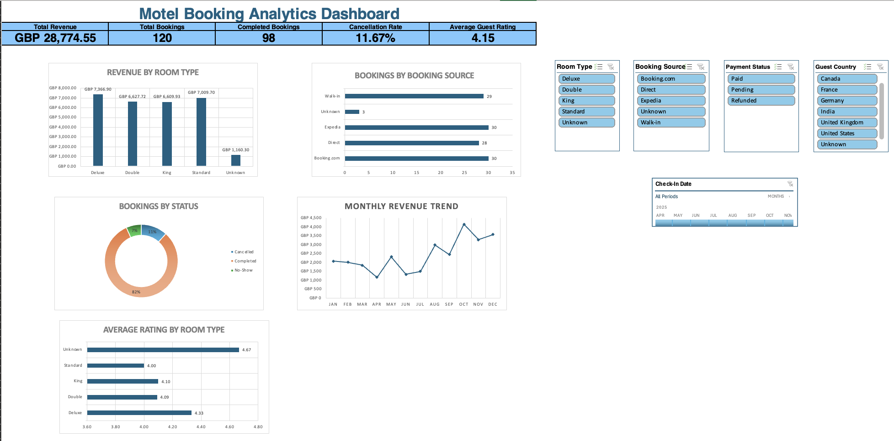

# Hospitality Booking & Revenue Performance

**An Excel analytics case study connecting booking activity, estimated revenue, cancellations and guest ratings.**

The workbook turns motel booking records into a management dashboard with native formulas, PivotTables, charts, slicers and a date timeline. The published scope is Excel: the repository contains the workbook and its actual dashboard capture.

[Open the Excel workbook](Excel/Hospitality_Booking_Revenue_Performa.xlsx) · [View the full-resolution dashboard](Excel/excel_dashboard.png)

## Business questions

- Which room types contribute the most estimated booking revenue?
- How are bookings distributed across direct, online-agent and walk-in channels?
- What share of bookings is cancelled, completed or marked as a no-show?
- How do monthly booking revenue and room-type ratings vary?

## Results in the saved workbook

| Metric | Saved value | Interpretation |
|---|---:|---|
| Cleaned bookings | **120** | Booking rows in the cleaned table |
| Completed bookings | **98** | Bookings marked Completed |
| Cancelled bookings | **14** | Bookings marked Cancelled |
| No-shows | **8** | Separate from cancellations |
| Cancellation rate | **11.67%** | 14 cancelled / 120 total bookings |
| Estimated booking revenue | **£28,774.55** | Sum of the workbook's Estimated_Revenue_GBP field |
| Average guest rating | **4.15** | Average of available numeric ratings; blanks are not zero |

The dashboard's “Total Revenue” card represents **estimated booking revenue**, not audited cash receipts, recognized revenue or profit. These numbers are the saved workbook snapshot, not a live booking feed.

## Findings and decisions to investigate

- **Deluxe** has the largest estimated room-type revenue at **£7,366.90**, followed by Standard at £7,009.70. Compare price, stay length and capacity before deciding which room type to expand.
- **Booking.com and Expedia each contribute 30 bookings**; walk-ins contribute 29 and direct bookings 28. Channel counts alone cannot establish channel profitability because commission and acquisition costs are absent.
- **October has the highest saved monthly estimated revenue, £4,162.18.** Review the underlying bookings before treating one year of observations as a seasonal pattern.
- Cancelled bookings and no-shows total **22 of 120 bookings**. Examine the two categories separately when considering reminder or cancellation policies.
- “Unknown” values are visible in the dashboard. Resolve classification gaps before drawing room-type or channel conclusions from small categories.

## Workbook structure and skills

| Sheets | Purpose |
|---|---|
| Data_Dictionary | Field descriptions and interpretation |
| Raw_Motel_Data | Original workbook records |
| Cleaned_Motel_Booking_Data | 120 cleaned bookings with stay and estimated-revenue fields |
| Excel_Analysis / Excel_Formula_Practice | KPI calculations and formula exercises |
| Pivot_* | Saved aggregation tables behind the KPIs and charts |
| Excel_Dashboard / Excel_Charts | Visual presentation, slicers and timeline |
| Business_Insights | Written interpretation and proposed actions |

The file contains **15 worksheets, 10 PivotTable definitions and 10 chart definitions**. Counts describe workbook objects, including supporting sheets; they do not imply ten separate dashboard visuals.

## Explore locally

1. Clone or download this repository.
2. Open `Excel/Hospitality_Booking_Revenue_Performa.xlsx` in desktop Microsoft Excel for the fullest slicer and timeline support.
3. Start on `Excel_Dashboard`, then inspect the cleaned table, formulas and supporting PivotTables.
4. Clear filters before comparing the KPI cards with the saved totals above. If you change the source table, refresh the affected PivotTables and check the formulas.

No cloud service, database or credential is required to review the published artifacts. The preview is static; interactivity is in the workbook.

## Validation and limits

The portfolio review inspected the XLSX package without rewriting it. Saved dashboard and PivotTable values agree for total bookings, completed bookings, cancellations, estimated revenue and average rating. The workbook contains no external-link relationships in the inspected package. Excel refresh, slicer behaviour and formula recalculation were not rerun in that review.

An independently verifiable upstream dataset citation or generation record is not included. Treat this as a **demonstration case study**; the repository does not establish that these are real commercial bookings. Booking counts do not establish occupancy without available room-nights, and the data do not establish profit, causal effects or realized business improvements.

No reuse license or upstream dataset license is supplied; publication alone does not establish reuse rights.
